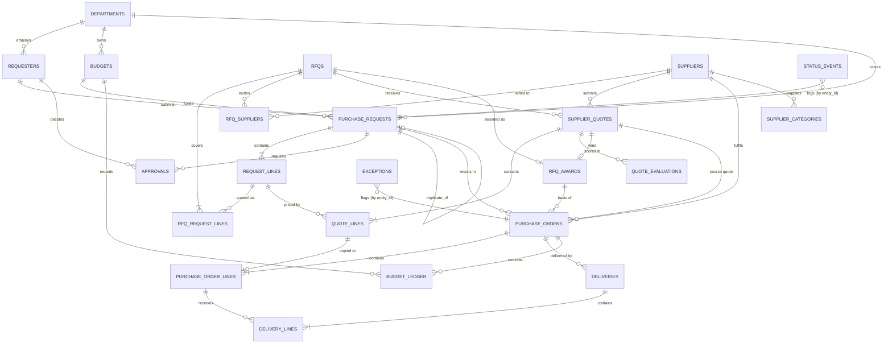

# ER Diagram & Relationships

## Entity-relationship diagram

## Cardinality summary

| Relationship | Cardinality | Notes |
|---|---|---|
| Department - Requester | 1:N | |
| Department - Budget | 1:N | unique per (department, fiscal year, category) |
| Budget - PurchaseRequest | 1:N | |
| PurchaseRequest - RequestLine | 1:N | `estimated_total` derived by trigger |
| RFQ - RequestLine | **N:M** | bridge `rfq_request_lines` |
| RFQ - Supplier (invited) | **N:M** | bridge `rfq_suppliers` |
| Supplier - Category | **N:M** | bridge `supplier_categories` |
| RFQ - SupplierQuote | 1:N | min 3 for competitive purchases |
| SupplierQuote - QuoteLine | 1:N | landed cost = lines + freight + duty + other |
| RFQ - Award | 1:0..1 | award stores basis and rationale |
| PurchaseRequest - Approval | 1:N | one row per required level |
| PurchaseRequest - PurchaseOrder | 1:N | PO may have no RFQ/quote (single source) |
| PurchaseOrder - POLine | 1:N | lines copy awarded quote lines |
| PurchaseOrder - Delivery | 1:N | N>1 means partial deliveries |
| Delivery - DeliveryLine - POLine | 1:N, N:1 | received vs ordered quantities |

## Optional relationships
`purchase_orders.rfq_id`, `quote_id`, `award_id` (single-source or low-value POs), `purchase_requests.duplicate_of_pr_id`, `budget_ledger.pr_id/po_id`, `purchase_order_lines.quote_line_id`.

## Lifecycle states

| Entity | States |
|---|---|
| PurchaseRequest | draft, submitted, pending_approval, approved, rejected, rfq_issued, awarded, po_issued, partially_delivered, delivered, closed, cancelled |
| RFQ | draft, issued, quotes_received, evaluated, awarded, cancelled, closed |
| SupplierQuote | submitted, under_review, awarded, rejected, expired, withdrawn |
| Approval | pending, approved, rejected, escalated |
| PurchaseOrder | draft, issued, acknowledged, partially_delivered, delivered, closed, cancelled |
| Delivery | scheduled, in_transit, partial, delivered, delayed, rejected, cancelled |
| Exception | open, acknowledged, resolved, waived |

State changes are written to `status_events` (append-only); nothing is overwritten.

## ID nomenclature

| Entity | Format | Example |
|---|---|---|
| PurchaseRequest | `PR-YYYY-NNNNNN` | PR-2026-000001 |
| RequestLine | `<PR-id>-LNN` | PR-2026-000001-L01 |
| RFQ | `RFQ-YYYY-NNNNNN` | RFQ-2026-000001 |
| SupplierQuote | `QUO-<supplier-code>-YYYY-NNNNNN` | QUO-SUP001-2026-000001 |
| QuoteLine | `<quote-id>-LNN` | QUO-SUP001-2026-000001-L01 |
| PurchaseOrder | `PO-YYYY-NNNNNN` | PO-2026-000001 |
| POLine | `<PO-id>-LNN` | PO-2026-000001-L01 |
| Delivery | `DEL-<PO-id>-NN` | DEL-PO-2026-000001-01 |
| Department / Requester / Supplier | `DEP-NNN` / `RQT-NNNNNN` / `SUP-NNNNNN` | DEP-001, RQT-000001, SUP-000001 |
| Budget / Approval / Award / Exception | `BUD-YYYY-NNNN` / `APR-` / `AWD-` / `EXC-YYYY-NNNNNN` | BUD-2026-0001 |

IDs are text primary keys, immutable, zero-padded, and enforced by `CHECK` regex constraints. Child IDs must start with their parent ID and match their sequence number, and the database rejects any mismatch.

## Rules enforced where

- **Hard constraints (structure):** keys, enums, date ordering, ID formats, line-ID/parent consistency.
- **Detected, not blocked (business rules):** approval thresholds, expired quotes, non-cheapest award without rationale, inactive supplier, budget overrun, duplicates, currency mismatch, split purchases, insufficient quotes, PO vs quote mismatch. These are visible in the `v_rule_violations` view so the labelled edge cases can exist and be caught.
- **Ground truth:** `ground_truth.anomaly_labels` is a separate schema, excluded from every view.
